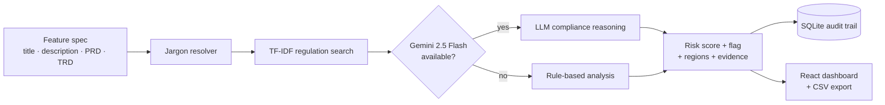

<div align="center">

<a href="https://rayaanq.github.io/Portfolio/#case-juristrack">
  <picture>
    <source media="(prefers-color-scheme: dark)" srcset="https://raw.githubusercontent.com/RayaanQ/RayaanQ/main/assets/card-juristrack-dark.svg">
    
  </picture>
</a>

# JurisTrack — Geo-Regulation Compliance Radar

**Scans social-platform feature specs for region-specific legal risk, decodes internal jargon, scores the risk and links every flag to the clause that triggered it.**


[Case study](https://rayaanq.github.io/Portfolio/#case-juristrack) · [Setup](#-getting-started) · [API](#-api)

</div>

---

## ✦ Why

Every new feature on a global platform has to clear a patchwork of regional laws. Manual legal review is slow, and internal codenames hide what a feature actually does. JurisTrack reads the spec the way a compliance lawyer would and answers three questions: **does this need geo-specific compliance, where, and why?**

## ✦ Features

- **Jargon resolution:** expands platform-specific acronyms and codenames before analysis, so the model reads what the feature actually does.
- **Regulation search:** TF-IDF retrieval over five regulations: **EU DSA** (fetched directly from EUR-Lex), **CCPA**, **Utah Social Media Act**, **Florida law** and **NCMEC** reporting.
- **Explainable decisions:** every flag comes with reasoning and the evidence snippets or clauses behind it.
- **Multi-factor risk score (0–100):**

  | Factor | Weight |
  |---|---|
  | Child safety | 40 |
  | Data privacy | 30 |
  | Content moderation | 25 |

  Tiers: **Low** 0–30 · **Medium** 30–70 · **High** 70–100.
- **LLM + fallback:** reasoning runs on Gemini 2.5 Flash, with a deterministic rule-based fallback so it still works without an API key.
- **Audit-ready:** every analysis is logged to SQLite, with batch analysis and CSV export.
- **Dashboard:** a React + Recharts view of risk distribution, flagged percentage and affected regions.

## ✦ How it works



### Example output

| Feature | Needs geo-compliance | Risk | Regions | Regulations |
|---|---|---|---|---|
| Curfew Mode for Teen Users | ✅ Yes | 85 | Utah, US | Utah Social Media Act, COPPA |
| Enhanced Personalization | ✅ Yes | 65 | EU; California, US | GDPR, CCPA |
| Basic Video Upload | ❌ No | 15 | – | – |

## ✦ Getting started

**Windows shortcut:** `setup.bat` creates the virtual environment and installs the Python and Node dependencies.

### 1. Backend (http://localhost:8000)

```bash
python -m venv venv
source venv/bin/activate          # Windows: venv\Scripts\activate
pip install -r requirements.txt
cp .env.template .env             # add GEMINI_API_KEY (optional, enables LLM analysis)
python main.py
```

### 2. Dashboard (http://localhost:3000)

```bash
npm install
npm start
```

Try the examples in [`sample_features.json`](sample_features.json), or run `python run_demo.py`.

## ✦ API

| Method | Endpoint | Description |
|---|---|---|
| `GET` | `/health` | Service health |
| `GET` | `/test-gemini` | Check the Gemini connection |
| `POST` | `/analyze-feature` | Analyze one feature: `{ title, description, prd?, trd? }` |
| `POST` | `/analyze-batch` | Analyze a list of features |
| `GET` | `/dashboard-data` | Aggregated metrics for the dashboard |
| `GET` | `/export-csv/{filename}` | Download an audit-ready CSV report |

Interactive docs are at http://localhost:8000/docs.

## ✦ Project structure

```
JurisTrack/
├── main.py                  # FastAPI app, endpoints, SQLite audit trail
├── compliance_analyzer.py   # LLM + rule-based analysis, risk scoring, evidence
├── regulation_kb.py         # regulation knowledge base + TF-IDF search (EUR-Lex fetch)
├── jargon_resolver.py       # acronym / codename expansion
├── run_demo.py              # command-line demo
├── sample_features.json     # example feature specs
├── data/                    # prebuilt TF-IDF vectorizer and regulation vectors
├── src/                     # React dashboard (App.js, ComplianceDashboard.js)
├── public/
├── requirements.txt · package.json · .env.template · setup.bat
```

---

<div align="center"><sub>Built by <a href="https://github.com/RayaanQ">Rayaan Quraishi</a> · <a href="https://rayaanq.github.io/Portfolio/">Portfolio</a> · <a href="https://www.linkedin.com/in/rayaan-quraishi">LinkedIn</a></sub></div>
